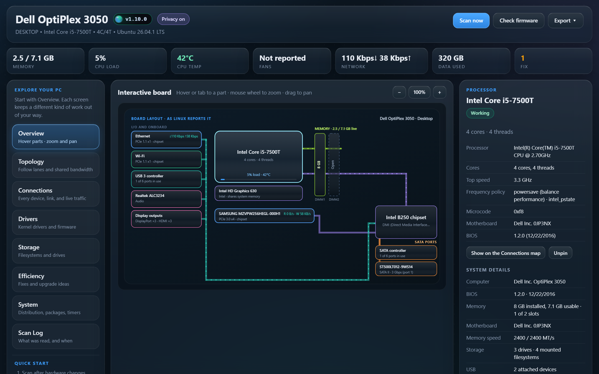

# BoardScout for Linux

The Linux edition shows the same views as the Windows app: the board, Topology, Connections (every
device and the link it negotiated, live traffic, Live drives, search, and the Optimization plan), Drivers,
Storage, Efficiency, System, and the Scan Log. It reads everything from the kernel's own files under
`/sys` and `/proc`, and serves the dashboard to your browser from a single program. Nothing needs root,
nothing is installed system-wide, and nothing is changed on the machine.

## Download and run

From the release, pick the build for your processor (`x64` for Intel and AMD PCs, `arm64` for a
Raspberry Pi 4 or 5 running a 64-bit OS, and other Arm boards):

| File | What it is |
| --- | --- |
| `BoardScout-<version>-linux-x64` | **Standalone.** One program with everything inside. |
| `BoardScout-<version>-linux-x64.tar.gz` | **Portable folder.** `boardscout` with its web views beside it. |
| `BoardScout-<version>-linux-SHA256SUMS.txt` | Checksums. |

Standalone:

    chmod +x BoardScout-<version>-linux-x64
    ./BoardScout-<version>-linux-x64

Portable folder:

    tar -xzf BoardScout-<version>-linux-x64.tar.gz
    ./BoardScout-<version>-linux-x64/boardscout

It prints a link and opens it in your browser. The .NET runtime is built in, and no ICU or other
libraries are needed beyond glibc (any current distribution).

**Add it to your app menu:** `boardscout --install` copies the standalone program to `~/.local/bin`
and adds a menu entry with an icon (the portable folder is used where it is). That entry stops
BoardScout when its last dashboard tab closes. `boardscout --uninstall` removes both.

**Run it again** and it opens the dashboard that is already running instead of starting another.
**Stop it** from the version button → Diagnostics → Stop BoardScout, or with Ctrl+C where it runs.
There's no tray icon: the dashboard lives in your browser.

## On a server or a headless machine

    boardscout --listen 0.0.0.0

serves the dashboard on your network and prints a link with an access key. Open that link from any
computer's browser. Anyone with the link can see the machine's details, so keep it private. To keep it
on the machine itself and reach it over SSH instead:

    ssh -L 8797:127.0.0.1:8797 you@server
    boardscout --no-browser          # on the server; open the printed link on your own computer

A systemd user service that keeps it running:

    # ~/.config/systemd/user/boardscout.service
    [Unit]
    Description=BoardScout dashboard

    [Service]
    ExecStart=%h/.local/bin/boardscout --no-browser
    Restart=on-failure

    [Install]
    WantedBy=default.target

`systemctl --user enable --now boardscout`, then `journalctl --user -u boardscout` shows the link.

## What it reads, and what adds detail

Always (every user may read these):

- **PCI** (`/sys/bus/pci`): every device, its driver, and the PCIe link it trained at against its best,
  with slot names from the firmware. Intel chipsets (PCH) and AMD chipsets are recognized, so the map
  shows what shares the chipset's link to the CPU.
- **USB** (`/sys/bus/usb`): controllers, hubs, every port, and the firmware's pairing of each socket's
  USB 2 and USB 3 halves, so sockets are counted once and a USB 3 device that came in on the USB 2 wires
  is flagged. Ports the firmware marks as not wired are left out. Power needs come from the devices' own
  descriptors; nothing is sent to a device.
- **Drives** (`/sys/block`, `/proc/diskstats`): NVMe, SATA (with the negotiated SATA speed, the drive's
  own maximum, firmware, and spin speed from its IDENTIFY data; never its serial number), USB (UAS or
  bulk-only), SD/eMMC, and every mounted filesystem, including LVM.
- **Network** (`/sys/class/net`, `/proc/net`): adapters, bridges, VPNs, routes, the router and the devices
  on your network (named the same ways as on Windows), and live traffic.
- **Sensors** (`/sys/class/hwmon`): CPU, GPU, chipset, and drive temperatures, fans, and GPU power,
  whatever the kernel's drivers expose.
- **Memory slots**: udev's copy of the firmware tables (`/run/udev/data/+dmi:id`), so channels, speed,
  part numbers, and makers show without root. Older systems need root for the raw table.
- **Monitors** (`/sys/class/drm`): each output, and the monitor's name and best mode from its EDID.
- **The OS**: `/etc/os-release`, packages (dpkg, rpm, or pacman, plus snaps and Flatpaks), package
  history, timers and cron jobs, support dates, and a security check.

When installed, these add more (each runs read-only, and the Scan Log lists every run):

| Tool | Adds |
| --- | --- |
| `iw` | Wi-Fi signal, band, rates, and the router's model from its Wi-Fi beacon |
| `nmcli` (NetworkManager) | Wi-Fi details, connection names, the connectivity check |
| `bluetoothctl` (BlueZ) | Paired Bluetooth devices |
| `udisksctl` (udisks2) | Eject for USB drives |
| `fwupdmgr` (fwupd) | Firmware versions and waiting updates (BIOS, SSDs, docks) |
| `apt-get` | Updates waiting, from a simulated upgrade |

## Differences from Windows

- **Interrupts**: Linux shows every user how many interrupts each device raises, so the plan's
  measurement needs no root, but it counts rather than times them (timing needs a root-only kernel trace).
- **Eject** unmounts the drive's filesystems through udisks and powers it off. Linux refuses for
  filesystems the system mounted (fstab) unless you're an administrator, and while a file is open.
- **Firmware**: Check firmware asks fwupd (the Linux Vendor Firmware Service) instead of vendor driver
  pages. BoardScout never installs anything.
- **Write caching** isn't a per-drive setting on Linux; USB drives are flushed when they're unmounted.

## Privacy

Privacy mode (version button → Settings) masks the same things as on Windows: the computer's name, your
user name and home folder, MAC addresses, Wi-Fi names, the names devices give themselves, IPv6 addresses,
and serial-like values. Copy diagnostics always masks them.

The dashboard serves only this computer unless you pass `--listen`, and every request needs the access
key printed at start. Settings, the log, and the running dashboard's address live in
`~/.local/share/boardscout` (or `$BOARDSCOUT_DATA`), readable only by you.

## Command line

    boardscout --help                 all options
    boardscout --connections-json     the Connections map (--privacy masks it, --sweep pings the network first)
    boardscout --plan-json            the optimization plan (--profile counts interrupts for 10 s)
    boardscout --system-json          the System tab's data
    boardscout --scan-json            the hardware scan (what Export saves)
    boardscout --selftest DIR         all of the above into DIR, for checking a machine over SSH

## Build from source

Requires the .NET 10 SDK, on Windows or Linux:

    ./Build-Linux.ps1                 # both linux-x64 and linux-arm64
    dotnet test tests/BoardScout.Linux.Tests

The version comes from `src/BoardScout.App/BoardScout.App.csproj`, shared with the Windows app.
